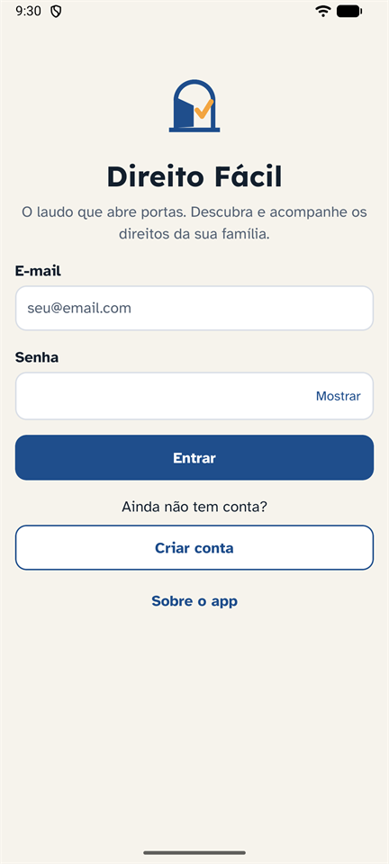
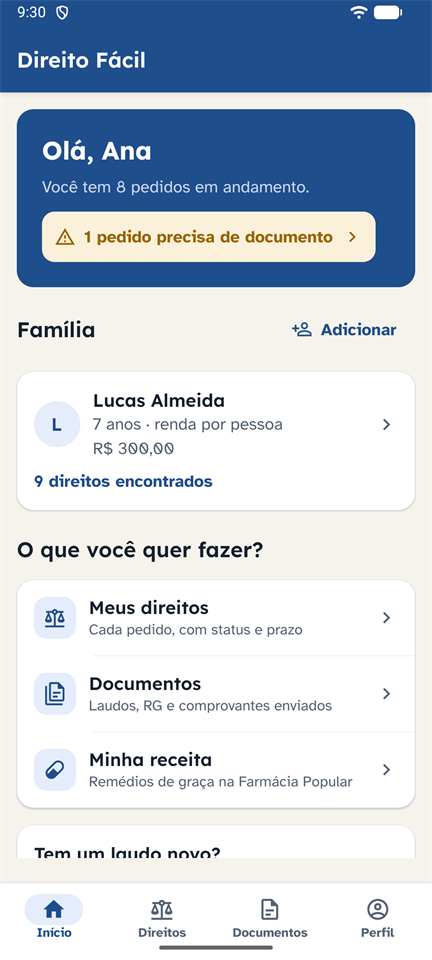
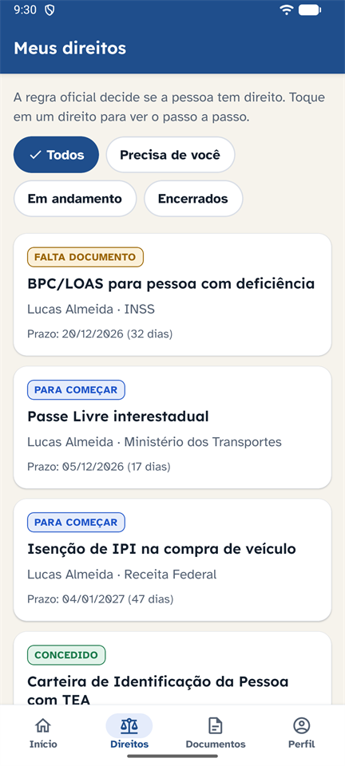
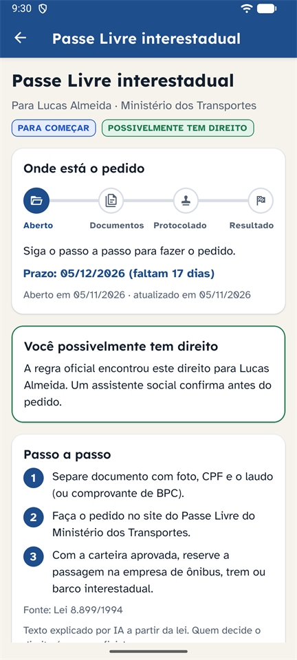
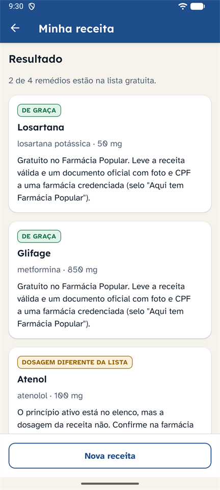
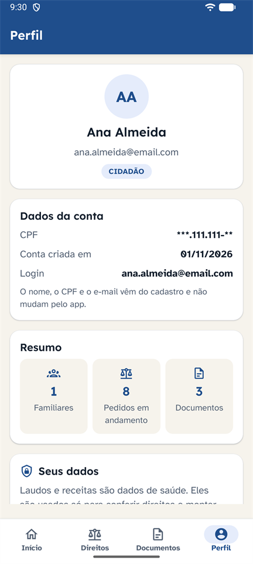

# Direito Fácil · App Mobile

App em React Native (Expo) do projeto **Direito Fácil**, Global Solution FIAP 2026/2 (CitizenTech), disciplina Mobile Application Development.

Famílias de pessoas com autismo (TEA), com deficiência (PcD) e idosos de baixa renda fotografam o laudo médico. A IA extrai os dados do laudo e uma regra oficial no banco decide a quais direitos federais a pessoa tem acesso. Cada direito vira um pedido acompanhado no app, do primeiro passo até a concessão.

> **A regra decide, a IA explica.** O app nunca afirma sozinho que alguém tem direito: ele mostra o resultado da regra (API Java + PL/SQL) e o passo a passo escrito pela IA, com a fonte legal. Quem confirma é o assistente social.

<table>
  <tr>
    <td align="center"><br />Login</td>
    <td align="center"><br />Início</td>
    <td align="center"><br />Meus direitos</td>
  </tr>
  <tr>
    <td align="center"><br />Detalhe do direito</td>
    <td align="center"><br />Minha receita</td>
    <td align="center"><br />Perfil</td>
  </tr>
</table>

## Vídeo de demonstração

[Assistir no YouTube](https://youtu.be/D15Zlaud8Q8): o APK rodando no celular, ligado às APIs publicadas.

## Acesso para testar

**[Baixar o APK](https://expo.dev/artifacts/eas/DFRqad4Ixh5U8scyHOGPtXLeVwSBXZwkzScSGHzRQrw.apk)** (gerado pelo EAS Build a partir do commit `5fefaac`).

O app já vem ligado às APIs publicadas. Basta instalar o APK e entrar com uma destas contas:

| Papel         | E-mail                      | Senha       |
| ------------- | --------------------------- | ----------- |
| Cidadão       | `ana.almeida@email.com`     | `Senha@123` |
| Gestor (CRAS) | `rafaela.gomes@cras.gov.br` | `Senha@123` |

Também dá para criar uma conta nova na tela de cadastro. Os dados são fictícios. Outras contas estão em [Contas de teste](#contas-de-teste).

> Se o app ficar parado na primeira entrada, aguarde: a API Java fica no plano gratuito do Render, que desliga quando não é usada e leva até 1 minuto para voltar.

> Na instalação, o Google Play Protect pode bloquear o APK, porque ele não veio da Play Store. Toque em **Mais detalhes** e depois em **Instalar mesmo assim**.

> Para a receita e os documentos, prefira tirar a foto pela **câmera** do app. A API aceita só JPEG, PNG e PDF, e alguns celulares guardam as fotos da galeria em HEIC ou WEBP.

## Base técnica

O app segue a arquitetura e as bibliotecas do app de referência das aulas (`mockmerce-app`):

| Peça               | Biblioteca                                                                              |
| ------------------ | --------------------------------------------------------------------------------------- |
| Navegação          | React Navigation (`native-stack` + `bottom-tabs`) com guarda de rotas e barra de abas   |
| Estado de servidor | TanStack Query (`useQuery` e `useMutation`)                                             |
| HTTP               | Axios, com **uma** instância e interceptors                                             |
| Credencial         | `expo-secure-store` (token)                                                             |
| Dado local         | `@react-native-async-storage/async-storage` (nome e papel do usuário, avisos já vistos) |
| Animação           | `react-native-reanimated` (toque, carregamento, entrada das listas, abas e avisos)      |
| Câmera e galeria   | `expo-image-picker`                                                                     |
| Ícones             | `@expo/vector-icons` (Material Design Icons, o conjunto do próprio Expo)                |
| Fontes             | `expo-font`, com os arquivos em `assets/fonts`                                          |
| Notificação        | `expo-notifications` (notificação local, sem push e sem Firebase)                       |

Expo SDK 58, a versão que o Expo Go atual abre.

## Telas

| #   | Tela                 | Papel   | O que faz                                                                                                               |
| --- | -------------------- | ------- | ----------------------------------------------------------------------------------------------------------------------- |
| 1   | Login                | público | Login real (JWT), validação e carregamento                                                                              |
| 2   | Cadastro             | público | Cria a conta (nome, CPF validado, e-mail, senha) e já entra                                                             |
| 3   | Início               | cidadão | Família, resumo dos pedidos e atalhos                                                                                   |
| 4   | Familiar             | cidadão | Dados, laudos e direitos de uma pessoa; editar e excluir                                                                |
| 5   | Novo/editar familiar | cidadão | Formulário com máscaras, validação e renda individual (POST e PUT)                                                      |
| 6   | Meus direitos        | cidadão | Casos com status, prazo, filtro e puxar para atualizar                                                                  |
| 7   | Detalhe do direito   | cidadão | Linha do tempo do pedido, resultado da regra, passo a passo da IA e fonte legal                                         |
| 8   | Documentos           | cidadão | Documentos enviados; apagar                                                                                             |
| 9   | Enviar documento     | cidadão | Câmera ou galeria, consentimento LGPD, `Idempotency-Key`                                                                |
| 10  | Pedir análise        | cidadão | Monta o envio do caso com os documentos e manda para o assistente social                                                |
| 11  | Minha receita        | cidadão | Familiar → foto da receita → conferência → Farmácia Popular                                                             |
| 12  | Perfil               | todos   | Dados da conta (`GET /api/v1/usuarios/me`, CPF parcial), resumo da família ou da fila, privacidade, trocar senha e sair |
| 13  | Fila de análise      | gestor  | Envios aguardando, devolvidos e aprovados                                                                               |
| 14  | Analisar envio       | gestor  | Aprovar ou devolver com observação                                                                                      |
| 15  | Trocar senha         | todos   | Senha atual e nova (`PATCH /api/v1/auth/senha`); senha atual errada mostra o erro no campo                              |
| —   | Sobre o app          | todos   | Versão e **hash do commit** do build (não conta nas telas)                                                              |

As telas principais ficam numa **barra de abas** embaixo: Início, Direitos, Documentos e Perfil para o cidadão; Fila e Perfil para o gestor. Os detalhes abrem por cima e cobrem a barra.

## Resultado da regra, em linguagem simples

| Resultado do banco | O que o app mostra                                                                                                                                                      |
| ------------------ | ----------------------------------------------------------------------------------------------------------------------------------------------------------------------- |
| `ELEGIVEL`         | "Você possivelmente tem direito". Nunca "você tem direito": um assistente social confirma antes do pedido.                                                              |
| `POSSIVEL`         | "Pode ser que você tenha direito", com o motivo vindo da API e o botão **Completar informação**, que abre o cadastro da pessoa no campo que falta. Não parece um "não". |
| Sem caso           | O direito não aparece na lista.                                                                                                                                         |

**Renda individual.** O cadastro da pessoa pergunta a renda dela própria (além da renda da família), usada no passe de ônibus para idosos (60+, até 2 salários mínimos de renda individual). São três respostas: o valor em reais, "Não tenho renda" (manda 0) e "Não sei / prefiro não informar" (manda vazio, nunca 0). Renda não informada deixa o passe como `POSSIVEL`.

**Receita (Farmácia Popular).** A pessoa escolhe de quem é a receita e a IA lê a foto. Antes da consulta, a pessoa confere e pode corrigir nome, princípio ativo e dosagem. O app registra a receita no familiar (`POST /receitas`), grava cada remédio em `/receitas/{id}/itens`, avisando se a pessoa corrigiu a leitura (`corrigido`), e lê o resultado em `GET /receitas/{id}`. O resultado tem três estados: **de graça**, **dosagem diferente da lista** e **fora da lista**, cada um com a orientação do banco. O app nunca sugere trocar de remédio ou de dosagem e sempre manda confirmar na farmácia credenciada.

## Arquitetura em camadas

```
Tela  ->  Hook  ->  Service  ->  client.ts  ->  API
```

**Nenhuma tela importa `axios`, `SecureStore`, um service ou o cliente HTTP.** Isso não é só combinado: a regra `no-restricted-imports` do `eslint.config.js` faz o `npm run lint` falhar se uma tela ou componente importar alguma dessas camadas.

```
src/
  api/         client.ts — a ÚNICA instância de Axios (API Java por padrão, .NET com API_DOTNET)
    mock/      adaptador de demonstração do Axios + dados fictícios
  config/      leitura do .env e do hash do commit
  errors/      AppError: o erro que a tela sabe mostrar
  types/       o contrato das APIs em TypeScript
  storage/     SecureStore (credencial) × AsyncStorage (dado) e a ponte do 401
  services/    "o que o app quer" -> "qual endpoint chamar"
  hooks/       estado de servidor com TanStack Query
  contexts/    sessão (AuthContext), avisos dos pedidos (AvisosContext) e snackbar
  navigation/  a guarda de rotas e os tipos de cada pilha
  components/  peças visuais reaproveitadas
  screens/     as telas
  lib/         tema, animações, queryClient, formatação, validação, rótulos, câmera, JWT
assets/
  fonts/       .ttf e licenças
  images/      logo e ilustração
docs/
  telas/       prints das telas principais
```

### Duas APIs, um cliente

| API                                                     | Responsável      | Rotas                                                                                                                                                                                                                      |
| ------------------------------------------------------- | ---------------- | -------------------------------------------------------------------------------------------------------------------------------------------------------------------------------------------------------------------------- |
| Java (Spring Boot) no Render                            | Biribilli e Alex | `POST /api/v1/auth/login`, `POST /api/v1/auth/registrar`, `PATCH /api/v1/auth/senha`, `GET /api/v1/usuarios/me`, `/api/v1/pessoas`, `/api/v1/pessoas/{id}/laudos`, `/api/v1/casos`, `/api/v1/direitos`, `/api/v1/receitas` |
| ASP.NET Core Web API (Controllers) no Azure App Service | Pietro           | `/api/documentos` (upload com `Idempotency-Key`), `/api/envios`, `/api/envios/{id}/submeter`, `/api/envios/{id}/analise`                                                                                                   |

O login acontece no Java e a API .NET aceita o mesmo token (nos dois, o `sub` é o e-mail). Por isso um interceptor só coloca o `Authorization` nas duas.

Só o `401` da API Java, que emite o token, encerra a sessão. Um `401` da .NET vira uma mensagem de erro na tela: durante a integração é comum a configuração do JWT ficar diferente entre as APIs, e o app não deve deslogar a pessoa a cada upload por causa disso.

O Java usa o prefixo `/api/v1`, fixo em `PREFIXO_JAVA` (`src/api/client.ts`). A .NET usa `/api`, que vem de `EXPO_PUBLIC_DOTNET_API_PREFIX` (padrão `/api`).

Endereços publicados:

- Java: https://direitofacil-java.onrender.com (rotas em `/api/v1`)
- .NET: https://direitofacil-rm561378.azurewebsites.net (rotas em `/api`)

O Render gratuito desliga a API Java quando ela fica parada, e a primeira chamada depois disso leva até 1 minuto. Por isso o timeout do Axios é de 70 segundos e, depois de alguns segundos esperando, o login e as telas de carregamento explicam a espera (servidor parado ou leitura da receita pela IA), sem trocar a mensagem da tela.

### Modo demonstração

Com `EXPO_PUBLIC_DATA_SOURCE=mock`, só o **adaptador** do Axios muda (`src/api/mock/adaptadorMock.ts`). Os services, os hooks, os interceptors e o tratamento de erro são os mesmos do modo real. O adaptador imita as regras das APIs (papéis, `400`/`401`/`403`/`404`/`409`/`413`/`415`/`422`, `Idempotency-Key` em UUID, listas paginadas da .NET, consentimento obrigatório para laudo e receita, limite de 10 MB), a regra do passe do idoso e a consulta da Farmácia Popular. Os dados ficam só em memória e voltam ao início quando o app reinicia.

**Na entrega, o app roda com `EXPO_PUBLIC_DATA_SOURCE=api`**: os dados ficam nas APIs, não no aparelho.

### Avisos dos pedidos

Quando o assistente social aprova ou devolve um envio, a família fica sabendo sem push e sem servidor de notificação (`src/contexts/AvisosContext.tsx`):

1. Com o app aberto ou em segundo plano, a lista de envios (`GET /api/envios`) é consultada de novo a cada minuto, e também quando o app volta para a frente.
2. Um envio que chegou a **aprovado** ou **devolvido** dispara uma **notificação local** no celular. Tocar nela abre o pedido.
3. Até a pessoa abrir o pedido, ele aparece como novidade: um cartão no Início e um número na aba Direitos.

O que já foi visto e avisado fica no celular, por conta. Na primeira entrada, o app só anota o estado atual, para decisões antigas não virarem aviso. A notificação do sistema só funciona no APK: no Expo Go o módulo nativo não existe, e o app segue só com o cartão e o número da aba. Com o app totalmente fechado nada chega, porque isso exigiria push.

## Como rodar

### Pré-requisitos

| Ferramenta                  | Versão                                                                                  |
| --------------------------- | --------------------------------------------------------------------------------------- |
| Node.js                     | 22.13 ou mais novo (testado com 24)                                                     |
| Expo Go no celular          | versão para o SDK 58 (a atual da loja)                                                  |
| Emulador Android (opcional) | Android Studio com um aparelho virtual com Google Play (testado com Android 17, API 37) |

### Passo a passo

```bash
npm install
```

Crie o `.env` a partir do exemplo. No macOS, no Linux ou no Git Bash:

```bash
cp .env.example .env
```

No Prompt de Comando do Windows:

```bat
copy .env.example .env
```

Inicie o Expo:

```bash
npx expo start --clear
```

Leia o QR code com o Expo Go ou aperte `a` no terminal para abrir no emulador Android.

> **Não roda na web.** O SecureStore não existe no navegador. Use celular ou emulador, como no app das aulas.

### Variáveis de ambiente

| Variável                        | Valores         | Para quê                                                                                                    |
| ------------------------------- | --------------- | ----------------------------------------------------------------------------------------------------------- |
| `EXPO_PUBLIC_DATA_SOURCE`       | `mock` ou `api` | Dados de demonstração ou APIs reais                                                                         |
| `EXPO_PUBLIC_JAVA_API_URL`      | URL             | API Java, sem o `/api/v1` no fim (o app coloca). No emulador Android, `http://10.0.2.2:8080` é o computador |
| `EXPO_PUBLIC_DOTNET_API_PREFIX` | `/api`          | Opcional. Prefixo das rotas da .NET (padrão `/api`)                                                         |
| `EXPO_PUBLIC_DOTNET_API_URL`    | URL             | API .NET, sem o prefixo no fim. Rodando local, `http://10.0.2.2:5264`                                       |

Depois de mudar o `.env`, reinicie com `npx expo start --clear`. Nada secreto vai nessas variáveis: tudo que começa com `EXPO_PUBLIC_` fica dentro do app.

### Contas de teste

As mesmas contas funcionam no modo demonstração e nas APIs publicadas. Todos os dados são **fictícios**, os da carga do banco (repositório `DireitoFacil-DB`: 20 direitos e 31 casos). Senha de todos: `Senha@123`.

Para a demonstração com as APIs publicadas, use a Ana (cidadã, mãe do Lucas) e a Rafaela (gestora): a Ana pede a análise de um direito do Lucas e a Rafaela aprova ou devolve o pedido.

| E-mail                      | Papel   | Família                        | Direitos                           |
| --------------------------- | ------- | ------------------------------ | ---------------------------------- |
| `ana.almeida@email.com`     | Cidadão | Lucas, 7 anos, autismo         | 9                                  |
| `carlos.menezes@email.com`  | Cidadão | Carlos, cadeirante             | 8                                  |
| `paula.souza@email.com`     | Cidadão | Helena, 68 anos                | 7                                  |
| `rita.barbosa@email.com`    | Cidadão | Rita, 66 anos, renda no limite | 7 (6 elegíveis e o BPC "possível") |
| `marcos.teixeira@email.com` | Cidadão | Marcos, sem deficiência        | 0 (teste negativo)                 |
| `rafaela.gomes@cras.gov.br` | Gestor  | Fila de análise do CRAS        | —                                  |

## Scripts

| Comando             | O que faz                                            |
| ------------------- | ---------------------------------------------------- |
| `npm start`         | Inicia o Expo                                        |
| `npm run android`   | Inicia e abre no emulador Android                    |
| `npm run lint`      | ESLint (config do Expo, Prettier e regra de camadas) |
| `npm run format`    | Formata com Prettier                                 |
| `npm run typecheck` | Checagem do TypeScript                               |

## Roteiro de testes manuais

1. **Sessão persiste.** Entre, feche o app pelo gerenciador de aplicativos e reabra: cai direto no início, sem piscar o login.
2. **Rota por papel.** Entre como `rafaela.gomes@cras.gov.br`: só a fila de análise existe. Entre como cidadão: a fila não existe.
3. **Logout limpa tudo.** Saia e entre com outra conta: nada da família anterior aparece.
4. **Resultado possível.** Entre como `rita.barbosa@email.com` e abra o BPC: aparece "Pode ser que você tenha direito", com o motivo e o botão **Completar informação**.
5. **Renda individual.** No cadastro da Rita, escolha "Não sei / prefiro não informar" e salve: o passe do idoso passa para "Pode ser que tenha direito".
6. **Receita.** Em Minha receita, escolha o familiar e fotografe uma receita. Com as APIs, a IA lê os remédios da foto; confira a leitura e veja o resultado da Farmácia Popular. No modo demonstração, qualquer papel serve: a leitura traz 4 remédios e o resultado mostra 2 de graça, 1 com dosagem diferente e 1 fora da lista.
7. **Aviso de decisão.** Entre como Ana, saia, entre como Rafaela e aprove o envio do Lucas. Volte como Ana: o Início mostra "Pedido aprovado" e a aba Direitos mostra 1. No APK, com a Ana logada e o app aberto, a notificação chega em até 1 minuto depois da decisão.
8. **`401` derruba a sessão.** Com a API real, expire o token e puxe uma lista: o app volta para o login sozinho, com aviso. Um `401` só da API .NET mostra erro, sem deslogar.

## Gerar o APK

O app é entregue como APK. A versão entregue precisa ser igual ao código do commit mostrado em "Sobre o app". O hash **não é preenchido à mão**: o `app.config.js` lê o `git rev-parse --short HEAD` na hora do build (ou o `EAS_BUILD_GIT_COMMIT_HASH`, no EAS Build). Se houver arquivo alterado e não commitado, o hash aparece com o sufixo `-alterado`, e esse APK não deve ser entregue.

### Pelo EAS Build (o APK entregue)

O APK entregue é gerado nos servidores do Expo, com o perfil `apk` do `eas.json`. Esse perfil já traz os endereços das APIs publicadas, porque o `.env` não sobe para o EAS.

1. Commite tudo e confira que `git status` está limpo.
2. Entre na conta Expo dona do projeto (`npx eas-cli login`) e rode:

   ```bash
   npx eas-cli build --platform android --profile apk
   ```

3. Baixe o APK pelo link que o comando mostra no fim, instale no celular, abra "Sobre o app" e confira que o hash é igual ao de `git rev-parse --short HEAD`.

O APK entregue foi gerado do commit `5fefaac`. Os commits depois dele só mudam este README (link do vídeo e dicas de instalação), sem tocar no código do app.

### No próprio computador

Precisa do Android Studio instalado (ele traz o Android SDK e o JDK). No Windows, ative os caminhos longos do sistema (`LongPathsEnabled`): as partes nativas do React Native passam do limite de 260 caracteres.

1. Commite tudo e confira que `git status` está limpo.
2. Confira que o `.env` está com `EXPO_PUBLIC_DATA_SOURCE=api` e os endereços publicados.
3. Gere o projeto Android nativo (a pasta `android/` fica fora do Git):

   ```bash
   npx expo prebuild --platform android --clean
   ```

4. O `prebuild` troca os scripts `android` e `ios` do `package.json`. Desfaça essa troca, senão o hash sai como `-alterado`:

   ```bash
   git checkout -- package.json
   ```

5. Compile o APK:

   ```bash
   cd android
   ./gradlew assembleRelease
   ```

   No Prompt de Comando do Windows, use `gradlew assembleRelease`. O APK sai em `android/app/build/outputs/apk/release/app-release.apk`.

6. Instale o APK no celular, abra "Sobre o app" e confira que o hash é igual ao de `git rev-parse --short HEAD`.

No APK a notificação do sistema funciona (ver [Avisos dos pedidos](#avisos-dos-pedidos)): na primeira entrada, o Android pede permissão para notificar.

## Uso de IA generativa

Declaração exigida pela disciplina.

- **No produto:** a API Java usa IA (Spring AI) para ler o laudo e a receita e para explicar o passo a passo de cada direito, com a fonte legal. A decisão sobre o direito vem da regra no banco, nunca da IA. O app avisa isso no detalhe do direito e obriga a pessoa a conferir a leitura da receita.
- **No desenvolvimento:** usamos um assistente de IA generativa para gerar parte do código (estrutura de pastas, camada de serviços, modo demonstração e telas), o ícone e as ilustrações. Todo o código foi revisado, testado e ajustado pelo grupo, que é responsável por ele.

## 👥 Integrantes da Equipe

| Nome                               | RM     | Turma  | GitHub                                            | LinkedIn                                                        |
| ---------------------------------- | ------ | ------ | ------------------------------------------------- | --------------------------------------------------------------- |
| **Alexander Dennis Isidro Mamani** | 565554 | 2TDSPG | [alex-isidro](https://github.com/alex-isidro)     | [LinkedIn](https://www.linkedin.com/in/alexander-isidro/)       |
| **Gabriel Neris Losano**           | 564093 | 2TDSPG | [GNLosano](https://github.com/GNLosano)           | [LinkedIn](https://www.linkedin.com/in/gabriellosano/)          |
| **João Vítor Biribilli Ravelli**   | 565594 | 2TDSPG | [biribillidev](https://github.com/biribillidev)   | —                                                               |
| **Kelson Zhang**                   | 563748 | 2TDSPG | [KelsonZh0](https://github.com/KelsonZh0)         | [LinkedIn](https://www.linkedin.com/in/kelson-zhang-211456323/) |
| **Pietro Paranhos Wilhelm**        | 561378 | 2TDSPG | [PietroWilhelm](https://github.com/PietroWilhelm) | [LinkedIn](https://www.linkedin.com/in/pietrowilhelm/)          |

---
